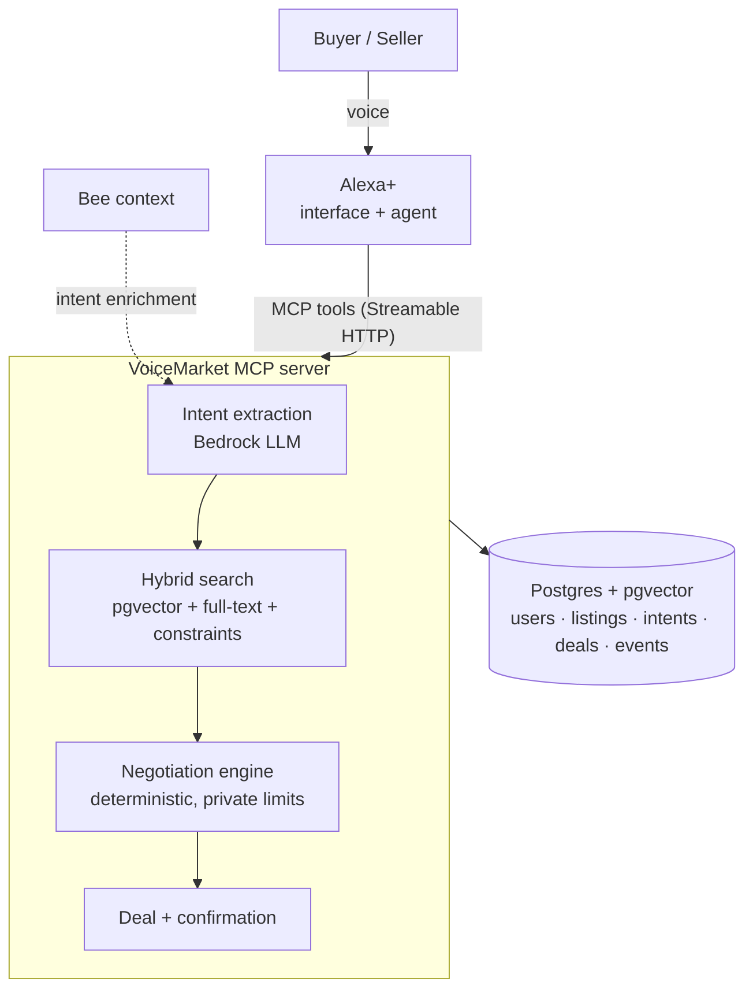

# VoiceMarket — a voice-first C2C marketplace for Alexa+

> People who have something and people who need something just say so.
> Alexa+ pairs each buyer with a seller, negotiates inside limits each side set
> privately, and asks both for a final "yes".

**Track:** Alexa+ (self-hosted MCP server, spec 2025-11-25, Streamable HTTP)
**Mini challenge:** AWS Builder (Amazon Bedrock embeddings + intent extraction, AWS hosting)
**Bee:** "Proactive Context Mode" turns real-world context into buy intents

## The idea in one minute

Trading directly with another person today means photos, forms, haggling in
chat and arranging a meet-up. That effort decides what gets traded: a spare
calculator or an unopened pack of tissues rarely finds the neighbour who needs it.

VoiceMarket pairs buyers and sellers directly and does the work in between.
Both sides post what they have or what they need, new or used:

- **Seller:** "Alexa, sell my TI-84 for $20. I'll take anything above $15."
- **Buyer:** "Alexa, I need a graphing calculator today, max $18."
- **Alexa:** "I found a TI-84 on campus and got it down to $17. Confirm?" — "Yes." — Done.

Neither side ever sees the other's limit. Our MCP server understands both
requests, pairs the buyer with the best-fitting seller, negotiates and records
the deal; Alexa+ is the voice and the agent; each person just says yes or no.

## Run it (2 minutes, no database or AWS needed)

```bash
npm install
npm run reset        # create tables + load seed listings
npm start            # MCP server on http://127.0.0.1:3000/mcp, dashboard on http://127.0.0.1:3000/
npm run smoke        # (second terminal) plays the TI-84 demo over real MCP
npm test             # unit + end-to-end tests (in-memory Postgres + pgvector)
```

Local dev uses **PGlite** — real Postgres + **pgvector** embedded in Node,
stored in `.data/`. Set `DATABASE_URL` to switch to a hosted Postgres.
`AI_MODE=mock` (default) works offline; `AI_MODE=bedrock` uses Amazon Bedrock.
See [.env.example](.env.example).

## Architecture



| Layer | Role |
|---|---|
| Alexa+ | Interface and agent: conversation, confirmation |
| MCP server (this repo) | Pairing intelligence: listings, buy intents, matching, negotiation, deals |
| Bee | Ambient context → proactive buy intents |

## MCP tools

| Tool | What it does |
|---|---|
| `create_listing` | Sell: item, public ask, **private minimum**, meet-up area |
| `create_buy_intent` | Buy: need + **private budget**; free text is parsed for missing fields |
| `find_matches` | Pairs a buy intent with sellers' listings: hybrid semantic + keyword search under hard constraints |
| `negotiate` | Settles a price inside both limits, creates a proposed deal |
| `confirm_deal` / `decline_deal` | Human-in-the-loop final decision |
| `get_deal_status` | Deals and meet-up details |

Full schemas and privacy rules: [docs/TOOL_CONTRACT.md](docs/TOOL_CONTRACT.md).

## Repo map

```
src/
  index.ts            entry point
  app.ts              HTTP: /mcp (Streamable HTTP), /health, /api/dashboard     [A]
  mcp/server.ts       MCP tool definitions                                       [A]
  market/service.ts   business operations behind each tool                       [B]
  market/matching.ts  hybrid pgvector + full-text search                         [B]
  market/negotiation.ts  deterministic price settlement                          [B]
  market/views.ts     the only place rows become output (privacy redaction)      [B]
  ai/                 mock + Bedrock embeddings and intent extraction            [C]
  db/                 PGlite / Postgres client and schema                        [B]
public/index.html     judge dashboard                                            [C]
data/seed-listings.json  seed marketplace                                        [C]
scripts/seed.ts, scripts/smoke.ts
docs/                 team handoff, contract, demo script, submission, friction log
```

## Team

See [docs/HANDOFF.md](docs/HANDOFF.md) for owners, tasks and the day-by-day plan.

## License

MIT — see [LICENSE](LICENSE).
