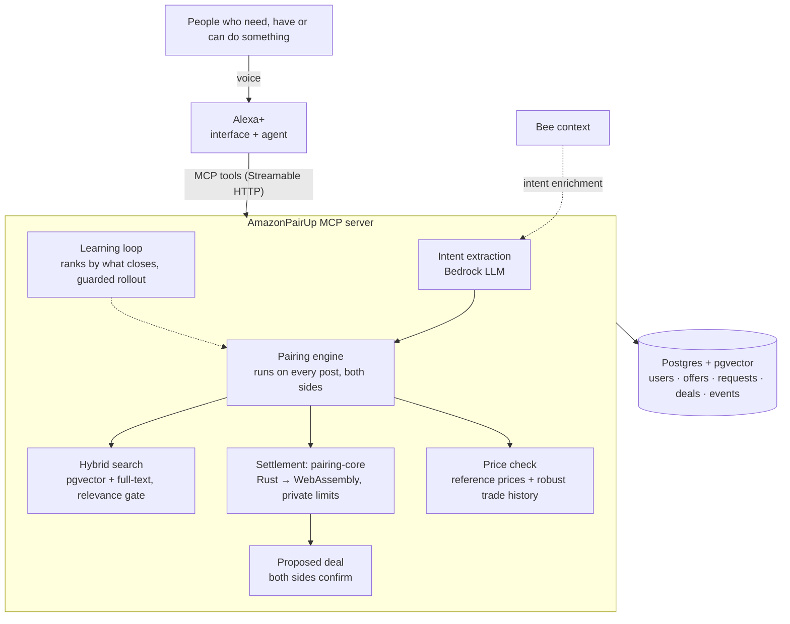

# AmazonPairUp — a voice-first C2C marketplace for Alexa+

> People who have something, people who can do something, and people who need
> either just say so. Alexa+ pairs each buyer with a seller, settles the price
> by a fixed rule inside limits each side set privately, and asks both for a
> final "yes".

**Track:** Alexa+ (self-hosted MCP server, spec 2025-11-25, Streamable HTTP)
**Mini challenge:** AWS Builder (Amazon Bedrock, a Strands Agents agent on Bedrock AgentCore Runtime, CloudFront + EC2 + CloudWatch)
**Bee:** "Proactive Context Mode" turns real-world context into requests
**Try it:** https://d3cxpkmhl89rw9.cloudfront.net/app/ · MCP endpoint `https://d3cxpkmhl89rw9.cloudfront.net/mcp` (OAuth 2.1)

## The idea in one minute

Getting something from another person today means photos, forms, haggling in
chat and arranging a meet-up. Getting a small job done means a platform that
adds its own fees on top. That effort and cost decide what happens: a spare
calculator rarely finds the neighbour who needs it, and nobody pays a delivery
app to carry a $5 lunch two buildings over.

AmazonPairUp pairs buyers and sellers directly and does the work in between,
for things and for services. Both sides post what they have, what they can do,
or what they need:

- **Things:** "Alexa, sell my TI-84 for $20. I'll take anything above $15." · "Alexa, I need a graphing calculator today, max $18." → "Found it: TI-84 Plus graphing calculator for $18, $2 below asking. Meet-up: HKUST campus. Should I confirm it?"
- **Errands and delivery:** "Alexa, find someone to pick up my lunch from LG7 canteen to Hall 5 by 12:30, $5." → a student already doing lunch runs on campus takes it for $4, and the fee goes to the person who walks.
- **One-time jobs:** "Alexa, get me a helper for the event on Saturday 2-6pm, budget $10 an hour." → "Found someone: Priya can do it for $10 an hour, $40 for 4 hours."

Neither side ever sees the other's limit. Our MCP server understands both
requests, pairs each request with the best-fitting offer of the same kind,
settles the price and records the deal; Alexa+ is the voice and the agent; each
person just says yes or no.

## How a price is set: no haggling

Agents don't bargain with each other here. Turn-by-turn haggling costs model
calls and seconds on every deal, and a model can be talked into revealing a
limit. One deterministic rule settles every deal instead, in
[pairing-core](https://github.com/rairurairu/pairing-core) (Rust compiled to WebAssembly):

- **The asking price is public.** A budget at or above it pays the ask.
- **A budget below it is the buyer's offer**, and the seller's private minimum
  decides whether it is accepted, like "best offer" with automatic acceptance.
- **The seller's minimum stays secret.** It never moves the price, so a deal
  shows only that the minimum was at most the price. A buyer who walks away
  from an offer never gets that listing cheaper later, so declining and asking
  again lower can't find the minimum.
- **One offer below the asking price per buyer and listing.** After a no, the
  asking price stands for that buyer ("The seller can't go that low. It's $20.
  Want it at that price?"), so stepping a budget up from below can't find the
  minimum either. Every other buyer still gets their own first offer.
- **The buyer's budget stays secret whenever it covers the ask.** A lower budget
  is the buyer's offer, so the seller sees it as the price.

**Price check.** A price far from what similar things go for gets a "did you
mean…?" before it is posted: a $1 iPhone, a minimum misheard as $1, a budget
heard as $180 for an $18 calculator. The typical range comes from reference
prices (a product catalog in production), or from the market's own confirmed
trades. Those trades are counted so that staged ones barely move the range: one
vote per seller, at least three independent sellers and buyers, accounts older
than a week, a median-based range. A buyer who is offered something far below
the usual price hears a safety note. The check never sets or blocks a price;
it only asks.

## Getting better every day

Every proposed deal records what the engine saw (relevance, same area,
urgency, delivery offered, pre-approved seller, condition margin, price against
the typical range, each side's track record), and its outcome is the label.
Each night ([learning.ts](src/market/learning.ts)) a small logistic model is
trained on older outcomes and judged on the newest ones. It replaces the
current ranking only if it ranks them better. 10% of requests always keep the
hand-tuned ranking as a live control, and the model rolls back automatically
if its completion rate falls behind. The model only reorders candidates that
already pass every hard constraint, and prices stay with the fixed rule. The
dashboard shows the daily completion rate, both arms, and what drives
completion in this market.

`npm run simulate` runs the real engine on simulated buyers who prefer nearby,
delivered and pre-approved offers; the engine is never told. Over 12 simulated
days the learned ranking closed 77% of its proposals against 59% for the
control, and it named delivery and same area as the main drivers.

## Run it (2 minutes, no database or AWS needed)

```bash
npm install
npm run reset        # create tables + load seed listings
npm start            # web app on http://127.0.0.1:3000/, MCP server at /mcp, operations dashboard at /dashboard/
npm run smoke        # (second terminal) plays the TI-84 demo over real MCP
npm test             # unit + end-to-end tests (in-memory Postgres + pgvector)
npm run simulate     # the learning loop on a simulated market, day by day
cd agents/agentcore && npm install && npm test   # the Strands agent against a real server
```

Local dev uses **PGlite** — real Postgres + **pgvector** embedded in Node,
stored in `.data/`. Set `DATABASE_URL` to switch to a hosted Postgres.
`AI_MODE=mock` (default) works offline; `AI_MODE=bedrock` uses Amazon Bedrock.
See [.env.example](.env.example).

## The web app

`/app/` is a complete AmazonPairUp client for phones, laptops and smart displays:
talk or type, see each offer as a card, and confirm or decline with a tap.
It works the way Alexa+ works with an MCP server:

- **It is an MCP host.** The browser runs a real MCP client: `tools/list` to
  discover tools, `tools/call` over Streamable HTTP with the signed-in user's
  token, `resources/read` for the view.
- **It renders MCP Apps.** Every result names the `ui://amazonpairup/market.html`
  view; the app draws it in a sandboxed iframe through the MCP Apps bridge, and the
  card's Confirm / Decline / "Get this one" buttons call tools through the host.
- **The reasoning step runs on the server** (`/api/agent`): Amazon Bedrock tool use
  when `AI_MODE=bedrock` and a model is set, otherwise an offline planner that
  covers the whole voice flow. Either way a deal is only confirmed after the
  user's explicit yes.
- **Sign-in** is OAuth 2.1 with PKCE as a public client (`AUTH_MODE=oauth`) with
  Login with Amazon. Local development and the labelled judge demo use a name and
  a passcode that the first sign-in with that name sets.
- **Offers that arrive while you're away** show up as a badge and a card, and are
  read out when voice is on.

Voice uses the browser's speech recognition and synthesis (Chrome, Edge, Safari);
typing works everywhere.

## Architecture



| Layer | Role |
|---|---|
| Alexa+ | Interface and agent: conversation, confirmation |
| MCP server (this repo) | Pairing intelligence: posts, matching, settlement, price checks, learning, deals |
| Bee | Ambient context → proactive buy requests |

## MCP tools

| Tool | What it does |
|---|---|
| `post_offer` | Offer an item to sell or a service you can do (per job or per hour): public price, **private minimum**, area. Pairs with a waiting request in the same call |
| `post_request` | Ask for an item or for help (pickup, drop-off, time, hours) + **private budget**. Pairs with the best offer and settles the price in the same call; returns alternatives |
| `find_matches` | More options for a request |
| `negotiate` | Take a different option instead; replaces the current deal |
| `confirm_deal` / `decline_deal` | Each side's yes or no; a no re-pairs both posts |
| `get_deal_status` | Deals and jobs waiting for your yes first, with counterpart, place and time |
| `list_my_posts` / `withdraw_post` | Your offers and requests; take one down, releasing any deal it held |
| `rate_deal` | 1 to 5 stars for the other side of a confirmed deal, once per side; feeds the track records the ranking learns from |
| `report_user` | Report the other side of a deal or the owner of an offer; the two are never paired again, and enough reports put someone under review |

Weapons, drugs, alcohol and tobacco, prescription medicine, recalled and
counterfeit goods, fake documents, cheating, adult services, live animals and
illegal services can't be posted, as items or as services: a keyword policy plus
an embedding match against [data/policy.json](data/policy.json) refuses them
before anything is stored, with a spoken `say` and an error `code`.

Every tool declares an output schema and annotations, and every write takes an
optional `idempotency_key` so a retried call never posts or confirms twice. Deals nobody answers expire (by the request's deadline at the latest)
and both posts are paired again; per-user posting limits and per-caller rate limits
protect the market. Pairing rules, schemas, limits and privacy rules:
[docs/TOOL_CONTRACT.md](docs/TOOL_CONTRACT.md).

## Built for agents

Any MCP host or agent framework can find AmazonPairUp, learn it and use it safely
without a human wiring it up:

| | |
|---|---|
| **Connect without setup** | Claude, ChatGPT, Cursor or a Strands agent connects to the hosted `/mcp` on its own: a Client ID Metadata Document (MCP 2025-11-25) or dynamic registration (RFC 7591), then a consent screen naming the client and Login with Amazon. Tokens refresh with rotation and revoke at `/oauth/revoke` (RFC 7009). [docs/TOOL_CONTRACT.md](docs/TOOL_CONTRACT.md#connecting-a-client) |
| **Agent Skill** | [skills/amazonpairup/SKILL.md](skills/amazonpairup/SKILL.md), in the open SKILL.md format and served at `/skills/amazonpairup/SKILL.md`: which tool for which sentence, how to read a deal, the rules, error codes, a worked example |
| **Server card** | `/.well-known/mcp/server-card.json`: endpoint, auth, instructions, and every tool, prompt and view with schemas, read from the live server |
| **llms.txt** | `/llms.txt`: the same in Markdown, with the rules an agent must follow |
| **Prompts** | `sell_something`, `find_something`, `whats_new` show up as starters in Claude, VS Code and the MCP Inspector |
| **Safe retries** | `idempotency_key` on every write; a retry returns the first result |
| **Speakable errors** | Every result and error has a `say` sentence; errors an agent can act on carry a `code` |
| **Strands + AgentCore** | [agents/agentcore](agents/agentcore): a Strands Agents voice agent on Amazon Bedrock AgentCore Runtime whose only tools are this server's, with a code-level guard that blocks `confirm_deal` until the user says yes |

## Production readiness

- **AWS:** CloudFront (HTTPS, HTTP/3, security headers) → EC2 Graviton with an IAM
  role (no access keys), encrypted EBS with daily snapshots, auto-recovery, deploys
  through Systems Manager with atomic release switching. [docs/DEPLOY.md](docs/DEPLOY.md)
- **Observability:** JSON logs in CloudWatch with a request id per call (`X-Request-Id`),
  CloudWatch metrics for MCP latency, tool failures and 5xx, alarms with email alerts,
  Embedded Metric Format for per-tool latency.
- **Reliability:** `/ready` checks the database before traffic switches; graceful
  shutdown drains calls in flight; holds expire and re-pair on a timer; Bedrock
  failures fall back to local parsing and the offline planner.
- **Safety:** OAuth 2.1 with PKCE, Login with Amazon as the identity provider,
  token revocation, SSRF-guarded client metadata fetches, Origin validation, CDN-only origin, per-caller rate
  limits, per-user posting limits, bounded inputs, private limits redacted in one
  place and leak-tested.
- **Trust and safety:** a prohibited and restricted items and services policy
  checked before every post, reports with a review queue on the dashboard, and
  ratings that feed each person's track record.
- **Speed:** `npm run bench` measures real MCP tool latency and throughput. See the measured local sample below.
- **Tests:** automated server tests (unit, end-to-end over MCP, HTTP, OAuth, schemas, privacy,
  idempotency) plus the Strands agent against a real server, on every push.

## Repo map

```
src/
  index.ts               entry point
  app.ts                 HTTP: /mcp (Streamable HTTP), /api/agent, /api/me, /health, /api/dashboard, /api/review, OAuth routes
  auth/oauth.ts          OAuth 2.1 account linking (PKCE, protected-resource metadata)
  mcp/server.ts          MCP tool definitions
  mcp/schemas.ts         output schemas for every tool
  mcp/prompts.ts         MCP prompts (sell_something, find_something, whats_new)
  mcp/discovery.ts       server card and llms.txt, read from the live tool list
  mcp/apps.ts            the MCP Apps view (ui://amazonpairup/market.html)
  agent/                 the web app's assistant step: Bedrock tool use, offline planner, confirm guard
  market/pairing.ts      pairing engine: pair on every post, atomic holds, release and re-pair
  market/matching.ts     hybrid pgvector + full-text search in both directions
  market/negotiation.ts  price settlement via pairing-core (Rust → WebAssembly)
  market/pricing.ts      price check: reference prices, robust trade-history range
  market/learning.ts     learning to pair better: features, model, guarded rollout
  market/policy.ts       what may be posted: keyword rules + embedding match (data/policy.json)
  market/trust.ts        reports, review status and the review queue
  market/amazon.ts       hand-offs to Amazon: search fallback, Trade-In, Hub meet-up points
  market/service.ts      business operations behind each tool
  market/views.ts        the only place rows become output (privacy redaction)
  market/idempotency.ts  retry-safe writes (idempotency_key)
  http/log.ts            JSON logs, CloudWatch Embedded Metric Format, request ids
  ai/                    mock + Bedrock embeddings and intent extraction
  db/                    PGlite / Postgres client, schema, seeding
src/web/                 the web app: OAuth PKCE sign-in, MCP client, MCP Apps host, voice
src/apps/                the MCP Apps view (deal card, options, deals, posts)
public/app/              web app shell + built bundle (npm run build:web)
public/mcp-apps/         built single-file MCP Apps view
public/dashboard/        operations dashboard
data/seed-listings.json  seed market: 162 posts from 22 people, items and services
data/policy.json         prohibited and restricted items and services
data/seed-listings.json  seed market: 162 posts from 22 people, items and services; demo Amazon Hub points per area
data/trade-in-categories.json  categories Amazon Trade-In takes
skills/amazonpairup/     the Agent Skill (SKILL.md)
agents/agentcore/        Strands Agents voice agent for Amazon Bedrock AgentCore Runtime
scripts/                 seed, smoke test, latency benchmark (bench.ts), add-on assets
docs/                    contract, award plan, Alexa+ setup, deploy, demo script, submission, friction log
vendor/pairing-core/     prebuilt module from https://github.com/rairurairu/pairing-core (refresh: node scripts/sync-pairing-core.mjs)
Dockerfile, deploy/      container image, AWS CloudFormation + deploy scripts, Lightsail config
```

## Plan

See [docs/AWARD_GAPS.md](docs/AWARD_GAPS.md) for the award analysis and the day-by-day plan.

## License

MIT — see [LICENSE](LICENSE).

Local benchmark (2026-10-20, Windows, Node v24.14.1, mock AI, PGlite, real HTTP MCP, 2 workers × 5 rounds, fresh users, 40 calls, zero errors): post_offer p50/p95/p99 49/235/235 ms; post_request 79/134/134 ms; find_matches 32/75/75 ms; confirm_deal 29/41/41 ms. Throughput 26.2 calls/s. This small local sample includes cold calls; measure Bedrock and the deployed network separately with `npm run bench`.
