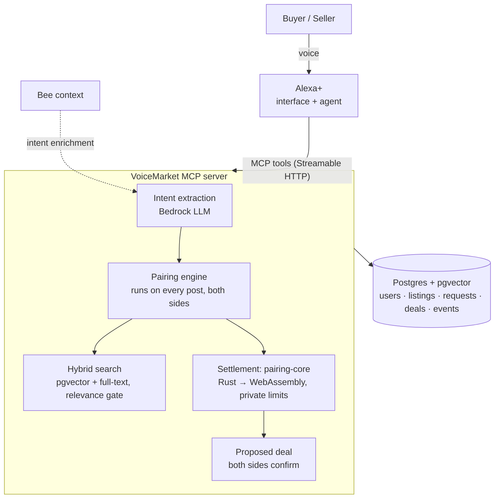

# VoiceMarket — a voice-first C2C marketplace for Alexa+

> People who have something and people who need something just say so.
> Alexa+ pairs each buyer with a seller, negotiates inside limits each side set
> privately, and asks both for a final "yes".

**Track:** Alexa+ (self-hosted MCP server, spec 2025-11-25, Streamable HTTP)
**Mini challenge:** AWS Builder (Amazon Bedrock embeddings + intent extraction, AWS hosting)
**Bee:** "Proactive Context Mode" turns real-world context into buy intents

## The idea in one minute

Trading directly with another person today means photos, forms, haggling in
chat and arranging a meet-up. That effort decides what gets traded: a spare
calculator or an unopened pack of tissues rarely finds the neighbour who needs it.

VoiceMarket pairs buyers and sellers directly and does the work in between.
Both sides post what they have or what they need, new or used:

- **Seller:** "Alexa, sell my TI-84 for $20. I'll take anything above $15."
- **Buyer:** "Alexa, I need a graphing calculator today, max $18."
- **Alexa:** "Found it: TI-84 Plus graphing calculator for $17, $3 below asking. Meet-up: HKUST campus. Should I confirm it?" — "Yes." — Done.

Neither side ever sees the other's limit. Our MCP server understands both
requests, pairs the buyer with the best-fitting seller, negotiates and records
the deal; Alexa+ is the voice and the agent; each person just says yes or no.

## Run it (2 minutes, no database or AWS needed)

```bash
npm install
npm run reset        # create tables + load seed listings
npm start            # web app on http://127.0.0.1:3000/, MCP server at /mcp, operations dashboard at /dashboard/
npm run smoke        # (second terminal) plays the TI-84 demo over real MCP
npm test             # unit + end-to-end tests (in-memory Postgres + pgvector)
```

Local dev uses **PGlite** — real Postgres + **pgvector** embedded in Node,
stored in `.data/`. Set `DATABASE_URL` to switch to a hosted Postgres.
`AI_MODE=mock` (default) works offline; `AI_MODE=bedrock` uses Amazon Bedrock.
See [.env.example](.env.example).

## The web app

`/app/` is a complete VoiceMarket client for phones, laptops and smart displays:
talk or type, see each offer as a card, and confirm or decline with a tap.
It works the way Alexa+ works with an MCP server:

- **It is an MCP host.** The browser runs a real MCP client: `tools/list` to
  discover tools, `tools/call` over Streamable HTTP with the signed-in user's
  token, `resources/read` for the view.
- **It renders MCP Apps.** Every result names the `ui://voicemarket/market.html`
  view; the app draws it in a sandboxed iframe through the MCP Apps bridge, and the
  card's Confirm / Decline / "Get this one" buttons call tools through the host.
- **The reasoning step runs on the server** (`/api/agent`): Amazon Bedrock tool use
  when `AI_MODE=bedrock` and a model is set, otherwise an offline planner that
  covers the whole voice flow. Either way a deal is only confirmed after the
  user's explicit yes.
- **Sign-in** is OAuth 2.1 with PKCE as a public client (`AUTH_MODE=oauth`), or a
  name-only sign-in in local development.
- **Offers that arrive while you're away** show up as a badge and a card, and are
  read out when voice is on.

Voice uses the browser's speech recognition and synthesis (Chrome, Edge, Safari);
typing works everywhere.

## Architecture



| Layer | Role |
|---|---|
| Alexa+ | Interface and agent: conversation, confirmation |
| MCP server (this repo) | Pairing intelligence: posts, matching, negotiation, deals |
| Bee | Ambient context → proactive buy requests |

## MCP tools

| Tool | What it does |
|---|---|
| `create_listing` | Sell: item, public ask, **private minimum**, meet-up area. Pairs with a waiting buyer in the same call |
| `create_buy_intent` | Buy: need + **private budget**. Pairs with the best seller and negotiates in the same call; returns alternatives |
| `find_matches` | More options for a request |
| `negotiate` | Take a different option instead; replaces the current offer |
| `confirm_deal` / `decline_deal` | Each side's yes or no; a no re-pairs both posts |
| `get_deal_status` | Deals waiting for your yes first, with counterpart and meet-up details |
| `list_my_posts` / `withdraw_post` | Your items and requests; take one down, releasing any deal it held |

Every tool declares an output schema and annotations. Offers nobody answers expire
and both posts are paired again; per-user posting limits and per-caller rate limits
protect the market. Pairing rules, schemas, limits and privacy rules:
[docs/TOOL_CONTRACT.md](docs/TOOL_CONTRACT.md).

## Repo map

```
src/
  index.ts               entry point
  app.ts                 HTTP: /mcp (Streamable HTTP), /api/agent, /api/me, /health, /api/dashboard, OAuth routes
  auth/oauth.ts          OAuth 2.1 account linking (PKCE, protected-resource metadata)
  mcp/server.ts          MCP tool definitions
  mcp/schemas.ts         output schemas for every tool
  mcp/apps.ts            the MCP Apps view (ui://voicemarket/market.html)
  agent/                 the web app's assistant step: Bedrock tool use, offline planner, confirm guard
  market/pairing.ts      pairing engine: pair on every post, atomic holds, release and re-pair
  market/matching.ts     hybrid pgvector + full-text search in both directions
  market/negotiation.ts  price settlement via pairing-core (Rust → WebAssembly)
  market/service.ts      business operations behind each tool
  market/views.ts        the only place rows become output (privacy redaction)
  ai/                    mock + Bedrock embeddings and intent extraction
  db/                    PGlite / Postgres client, schema, seeding
src/web/                 the web app: OAuth PKCE sign-in, MCP client, MCP Apps host, voice
src/apps/                the MCP Apps view (deal card, options, deals, posts)
public/app/              web app shell + built bundle (npm run build:web)
public/mcp-apps/         built single-file MCP Apps view
public/dashboard/        operations dashboard
data/seed-listings.json  seed marketplace
scripts/                 seed, smoke test, add-on assets
docs/                    contract, award plan, Alexa+ setup, deploy, demo script, submission, friction log
vendor/pairing-core/     prebuilt pairing-core module (refresh: node scripts/sync-pairing-core.mjs)
Dockerfile, deploy/      container image and Lightsail config
```

## Plan

See [docs/AWARD_GAPS.md](docs/AWARD_GAPS.md) for the award analysis and the day-by-day plan.

## License

MIT — see [LICENSE](LICENSE).
