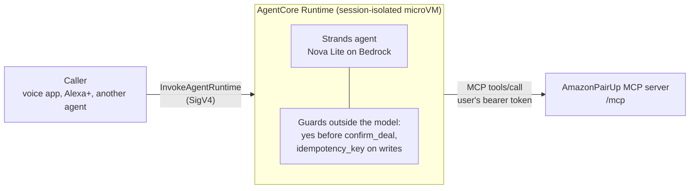

# AmazonPairUp agent on Amazon Bedrock AgentCore

A voice agent for AmazonPairUp built with **Strands Agents** (TypeScript SDK)
and hosted on **Amazon Bedrock AgentCore Runtime**. Its tools are the
AmazonPairUp MCP server's, discovered over Streamable HTTP with the user's own
credentials, and its model is Amazon Nova Lite on **Amazon Bedrock**.



What runs outside the model, in code:

- **No confirmation without a yes.** A `BeforeToolCallEvent` hook cancels
  `confirm_deal` unless the user's latest words are an explicit yes; the agent
  then asks "Should I confirm it?".
- **Retry-safe writes.** The same hook gives every write tool an
  `idempotency_key`, so a retried call never posts or confirms twice.
- **The user's own permissions.** The agent calls MCP with the user's token,
  so it can only do what that user could do in the web app.
- **Conversation per session.** Each AgentCore session keeps its own agent and
  conversation; idle ones are dropped first when `MAX_SESSIONS` is reached.

## Files

| File | What it is |
|---|---|
| [src/agent.ts](src/agent.ts) | The Strands agent: Bedrock model, MCP client, system prompt, guards |
| [src/main.ts](src/main.ts) | AgentCore Runtime entrypoint (`BedrockAgentCoreApp`): `POST /invocations`, `GET /ping`, streamed replies |
| [src/chat.ts](src/chat.ts) | Talk to the agent in a terminal |
| [src/check.ts](src/check.ts) | Checks the MCP wiring without a model or AWS credentials |
| [test/agent.test.ts](test/agent.test.ts) | The agent against a real in-process server, with a scripted model |
| [Dockerfile](Dockerfile), [deploy.sh](deploy.sh), [invoke.sh](invoke.sh) | ARM64 image, deploy to AgentCore, invoke it |

## Run it locally

```bash
npm install                       # in the repo root first, then here
npm test                          # agent + guards against a real server, no AWS needed
PAIRUP_MCP_URL=http://127.0.0.1:3000/mcp npm run check    # with `npm start` running in the repo root
PAIRUP_MCP_URL=http://127.0.0.1:3000/mcp PAIRUP_USER=u_mei npm run chat   # needs AWS credentials with Bedrock access
```

`npm start` here serves the AgentCore contract on port 8080:

```bash
curl -N http://127.0.0.1:8080/invocations -H "Content-Type: application/json" -H "Accept: text/event-stream" \
  -H "X-Amzn-Bedrock-AgentCore-Runtime-Session-Id: local-session-0000000000000000000000" \
  -d '{"prompt":"any news?","user_id":"u_mei"}'
```

## Deploy to AgentCore Runtime

```bash
AWS_PROFILE=amazonpairup AWS_REGION=us-east-1 ./deploy.sh
PAIRUP_TOKEN=<access token> ./invoke.sh "I need a graphing calculator today, max 18 dollars"
```

`deploy.sh` builds the ARM64 image, pushes it to ECR, creates an execution role
limited to Bedrock model calls, ECR pulls and logs, and creates or updates the
agent runtime. Settings: `PAIRUP_MCP_URL` (default the production server),
`BEDROCK_MODEL_ID` (default `us.amazon.nova-lite-v1:0`), `MAX_SESSIONS`.

Identity in production: pass the user's AmazonPairUp access token as
`pairup_token` in the payload, or in the
`X-Amzn-Bedrock-AgentCore-Runtime-Custom-PairUp-Token` header once that header
is on the runtime's request header allowlist. The MCP server only accepts
OAuth tokens in production, so `user_id` works only against a local server.
